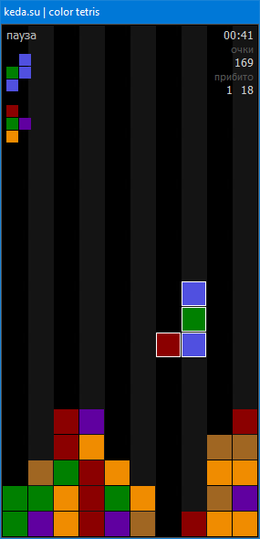
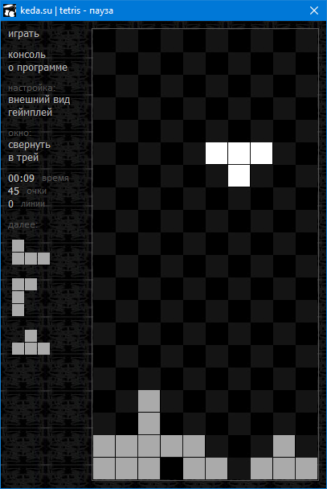
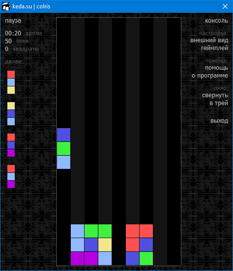
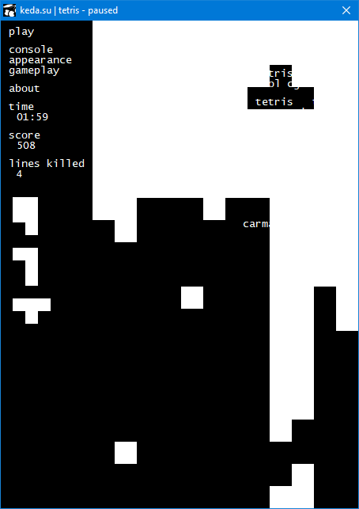
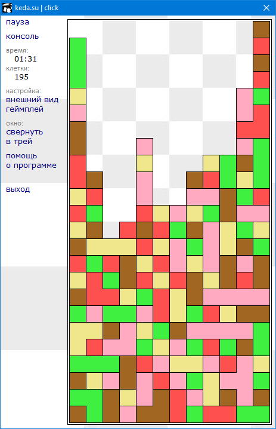
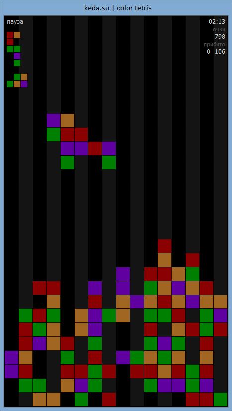
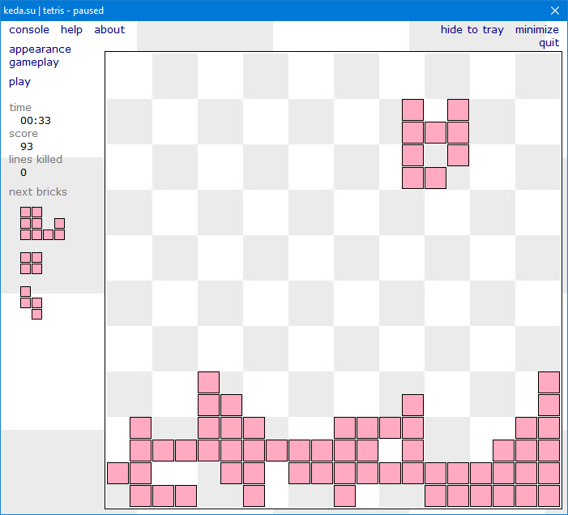

## Игры для Windows - Tetris, Color Tetris, Colris, Click

* **Год написания:** 2007, 2017
* **Среда разработки:** Delphi (Borland Developer Studio 2006)
* **Статус:** Архив

В далеком 2007 году при разработке данных игр автора захватило кратковременное безумие. Вместо игр у него получились конструкторы, в которых можно изменить все. Есть полная настройка внешнего вида, полная настройка процесса игры, назначение любых сочетаний клавиш на любые действия и многое другое. И всё это делается через консоль со встроенным языком программирования!

В 2017 был небольшой ремастеринг, связанный с поддержкой увеличенных PPI рабочего стола. 

Скачать игры можно в [разделе релизов](./../../releases).

Или на сайте [**ich.su**](https://games.ich.su/windows/). Там же больше информации.

Также существует безумный онлайн вариант игр: [games.ich.su](https://games.ich.su), [github](https://github.com/ich-su/games.ich.su)

Скриншоты:

* 
* 
* 
* 
* 
* 
* 

[больше скриншотов](https://games.ich.su/windows/)

страница проекта на гитхабе:
[github.com/ich-su/games](https://github.com/ich-su/games)

страница на games.ich.su:
[games.ich.su/windows](https://games.ich.su/windows/)
